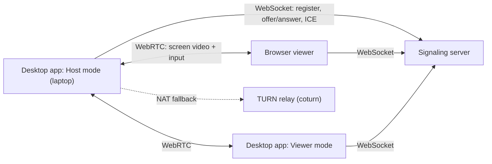

# Orbit

Access your computer from anywhere, from a browser or from a desktop app. Orbit works like AnyDesk or TeamViewer: the computer you want to reach runs the desktop app and gets a 9-digit Device ID and a password, and you connect to it from any other device.

- **Desktop app (Windows, macOS, Linux)** shares the computer's screen and accepts mouse and keyboard input. The same app can also connect to other computers.
- **Browser viewer** needs no install. Open the server's address, type the Device ID and password, and control the remote screen.
- **Peer-to-peer.** Video and input go directly between the two devices over WebRTC (encrypted with DTLS-SRTP). The server only introduces the two sides, and a TURN relay is used as a fallback on strict networks.



## Features

- Device ID and password pairing, with a per-connection **Allow / Deny prompt** on the host (or opt in to unattended access)
- Always-visible banner and tray entry on the host while someone is connected, with a Disconnect button
- Live screen, mouse (move, click, drag, scroll) and keyboard control, including special combos (Ctrl+Alt+Del, Alt+Tab, Win/Cmd key)
- Multi-monitor selection, quality presets (15 / 30 / 60 fps), fit-to-window or 100% scaling, view-only mode, fullscreen with keyboard lock
- Clipboard text sync in both directions and file send (up to 200 MB) to the host's `Downloads/Orbit` folder
- Connection stats (latency, fps, bitrate), recent devices, and clear error states for wrong password, offline device, declined or timed-out requests, busy device, and lockouts

## Repository layout

| Package | What it is |
| --- | --- |
| `packages/shared` | Signaling messages and input-event schemas (zod), used by every other package |
| `packages/server` | Fastify + WebSocket signaling server. Also serves the built browser viewer |
| `packages/viewer` | React + Vite + Tailwind + shadcn/ui app. It is the browser viewer **and** the UI inside the desktop app |
| `packages/desktop` | Electron app: screen capture, input injection (nut.js), consent prompt, tray, banner, file receive |

## Quick start (development)

Requirements: Node.js 20+ (22 recommended).

```bash
npm install
npm run dev        # signaling server on :47831, viewer dev server on :47832
```

In a second terminal, start the desktop app on the computer you want to control:

```bash
npm run desktop
```

The **This computer** tab shows your Device ID and password. Then, from another device or another browser tab, open <http://localhost:47832> (dev) or <http://localhost:47831> (after `npm run build`), enter the ID and password, and connect. Approve the prompt on the host.

To use the desktop app as the viewer, switch to its **Connect** tab.

## Production build

```bash
npm run build      # viewer -> server bundle -> desktop bundle
npm start          # serves the viewer and signaling on http://0.0.0.0:47831
npm run dist       # installers for the current OS into packages/desktop/release
```

`npm run dist` uses electron-builder: Windows (NSIS and portable), macOS (dmg and zip), Linux (AppImage and deb). Build each installer on its own OS. Code signing and notarization are not configured; unsigned builds trigger OS warnings.

## Installers (Windows, macOS, Linux)

`.github/workflows/release.yml` builds the installers on GitHub's own Windows, macOS and Linux machines:

| OS | Output |
| --- | --- |
| Windows | `Orbit-Setup.exe` (installs, adds Start menu and desktop shortcuts) |
| macOS | `Orbit-<arch>.dmg` and `.zip` (Apple silicon and Intel) |
| Linux | `Orbit.AppImage` and `.deb` |

Run it from the repo's **Actions** tab (**Build installers**, then **Run workflow**) and download the installers from the run's artifacts. Or push a tag such as `v0.1.0` (`git tag v0.1.0 && git push github v0.1.0`) and the installers are attached to a GitHub Release. The installers are not code-signed, so Windows SmartScreen and macOS Gatekeeper warn on first launch (Windows: More info, then Run anyway; macOS: right-click the app, then Open).

After installing, open Orbit and use **Change** next to **Server** on the **This computer** tab to set your server address. The installed app runs in the system tray, so it stays reachable after you close its window. Use the tray menu for **Start at login**.

## Free hosting on Render

`render.yaml` deploys the signaling server (and the browser viewer) as a Docker web service:

1. On render.com choose **New, Blueprint**, connect this GitHub repo, and apply `render.yaml`.
2. When it is live you get an address like `https://remoteshare-server.onrender.com`. Open it in a browser to use the viewer, and paste the same address into **Server** (Change) in the desktop app on both laptops.

The free plan sleeps after 15 minutes without traffic (the first connection after that takes about a minute) and does not keep disk data, so Device IDs are re-claimed after a restart. Use a paid plan with a disk (set `DATA_DIR` to the disk mount) or a VPS for always-on use.

## Access from other locations

Connections only work from outside your home network if the server is reachable from the internet, so run the server somewhere public (a small VPS is plenty, because it carries no video).

1. Deploy the server, either with Node (`npm run build && npm start`) or Docker:

   ```bash
   cp .env.example .env
   docker compose -f docker/docker-compose.yml --env-file .env up -d
   ```

2. Put HTTPS in front of it and set `TRUST_PROXY=1`. With Caddy, for example:

   ```
   remote.example.com {
       reverse_proxy localhost:47831
   }
   ```

   HTTPS is required for the browser viewer's clipboard buttons and is strongly recommended anyway. The app switches to `wss://` automatically.

3. In the desktop app, open Settings and set the server address to `https://remote.example.com`. Use the same address in the browser.

4. Add a TURN relay if some networks (corporate Wi-Fi, mobile carriers) cannot connect peer to peer. The compose file includes coturn behind a profile:

   ```bash
   # .env: TURN_URL=turn:YOUR_IP:3478  TURN_USER=remotedesk  TURN_PASS=<long random>  TURN_EXTERNAL_IP=YOUR_IP
   docker compose -f docker/docker-compose.yml --env-file .env --profile turn up -d
   ```

   Open UDP/TCP 3478 and UDP 49160-49200 on the firewall. The server hands the TURN credentials to both peers when a session starts.

### Server configuration

| Variable | Default | Purpose |
| --- | --- | --- |
| `PORT` / `HOST` | `47831` / `0.0.0.0` | Listen address |
| `TRUST_PROXY` | `0` | Trust `X-Forwarded-For` (set to `1` behind a reverse proxy) |
| `DATA_DIR` | `packages/server/data` | Stores device IDs (hashes of host keys only) |
| `VIEWER_DIR` | `packages/viewer/dist` | Built browser viewer |
| `STUN_URLS` | Google STUN | Comma-separated STUN URLs |
| `TURN_URL`, `TURN_USER`, `TURN_PASS` | unset | TURN relay credentials |
| `CONSENT_TIMEOUT_MS` | `30000` | How long a host has to approve a request |

The desktop app reads `RD_SERVER_URL` for its default server address on first launch.

## Security model

- A viewer needs the Device ID **and** the password. Passwords are hashed with scrypt on the server, and held in memory only.
- Failed attempts are rate limited per Device ID (5 failures, 10 minute lock) and per IP (20 failures, 10 minute lock).
- Each session has an unguessable ID, and signaling is only relayed between the two participants.
- By default the host must click Allow for every connection. **Unattended access** skips the prompt for anyone with the password, so use a long password if you enable it. The password is stored in the app's config file (`config.json` in the Electron user-data folder, mode 0600).
- Remote input is only injected after a session is accepted and stops when it ends. A banner stays on top of the host screen during a session, and the host can disconnect at any time.
- A Device ID can only be reclaimed by the machine that holds its secret host key.
- The Electron renderer is sandboxed with context isolation. Every IPC message is validated, and only the app's own window may use it.

Anyone who can reach your server can try to connect to a Device ID, so keep passwords long, and keep unattended mode off unless you need it.

## Platform notes

- **macOS:** grant **Screen Recording** and **Accessibility** to Orbit (System Settings, Privacy & Security). The **This computer** tab detects missing permissions and offers buttons that open the right pane. Restart the app after granting Screen Recording.
- **Windows:** windows running as administrator (and the UAC prompt, lock screen and Ctrl+Alt+Del screen) cannot be controlled unless Orbit itself runs as administrator. Ctrl+Alt+Del cannot be injected by any user-mode app, so the toolbar combo is best effort.
- **Linux:** X11 sessions work fully. On **Wayland**, capture goes through a system prompt and input injection is not available, so viewers get a view-only session (the app tells you so). Log in with an X11 session for full control. `libxtst` must be installed for input injection.
- Keyboard layouts: keys are sent as physical key codes, so the host's layout decides which characters appear.

## Tests

```bash
npm run typecheck   # all packages
npm test            # server unit tests (pairing, consent, rate limiting, relay rules)
npm run build && npm run e2e
```

`npm run e2e` is a Linux end-to-end test. It starts the server, an Electron host under Xvfb and a Chrome viewer through Playwright, and then checks wrong passwords, offline devices, denied and timed-out consent, video, real pointer movement, clicks, scrolling and typing on the host's X display, clipboard sync in both directions, file transfer, a refused second viewer, both ways to end a session, and the Electron app acting as a viewer. It needs `Xvfb`, `xdotool`, `xev`, `xclip` and a Chrome or Chromium binary (set `CHROME_PATH` if it is not in a standard location). The test-only `RD_E2E` environment variable lets the host skip its native consent dialog.

What has been exercised: everything above on Linux (X11), plus a packaged Linux build. macOS and Windows code paths (permissions guide, DIP-to-pixel mapping, installers) are written but have not been run on those systems.

## Limitations

- Text clipboard only (no images or files through the clipboard), and file transfer goes viewer to host only.
- No audio forwarding, no session recording, and no multi-viewer sessions (one viewer per host at a time).
- Device IDs and passwords live in a single server process. Run one instance (state is in memory), and expect hosts to reconnect automatically after a restart.

## Hosting the browser viewer on Vercel

The browser viewer is a static site, so it deploys to Vercel as-is (`vercel.json` is included). Vercel cannot run the signaling server, because that needs long-lived WebSocket connections. Run the server on a VPS, Fly.io, Railway or similar (see "Access from other locations"), then point the viewer at it with either the **Settings** dialog or a `VITE_SERVER_URL` environment variable (for example `https://remote.example.com`) set in the Vercel project before building.
